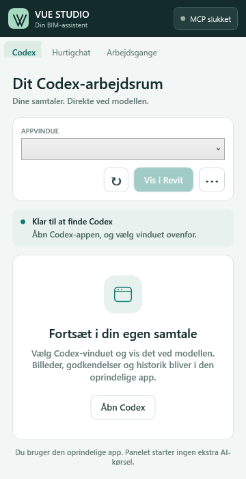

# VUE Studio for Revit

VUE Studio 2.7 is Lucas and Rasmus' Revit/MCP workspace for their VUE project. It adds a dedicated **VUE Studio** ribbon tab, a dockable panel, visible connection state and local starters for the group's five workflow books. Revit plugins load through Autodesk's add-in API; this package preserves the existing add-in ID and installation path so an upgrade does not create a second plugin.



## Start

1. Install the Revit 2026 candidate with Revit closed (see below).
2. Open a model and select **VUE Studio > MCP slukket** to turn the connection on. The label and icon change to **MCP tændt** only when the listener is running. **MCP fejl** shows a failed start or listener failure.
3. Choose **Åbn Studio**. Keep Codex open and signed in.
4. Under **Codex**, choose the original app window and select **Vis i Revit**. You use the app's actual input, history, attachments and approvals.
5. If its native minimum size is larger than the panel, enlarge/float the panel or choose **Brug på skrivebord**. This returns the same window and conversation, rather than starting another chat.

The panel's power control uses a Revit ExternalEvent. It does not call model APIs from a background thread. Power status means the Revit listener is on/off; it is separate from Codex sign-in, model availability and actual client connection. Turning off closes existing clients and rejects new/buffered commands from that listener generation. A command already admitted may finish.

**Hurtigchat** sends text to an existing desktop-owned chat. It retains that chat's settings and does not resume it in a second inference session. This private desktop IPC protocol is experimental and may change between app versions. Images, approvals, interactive questions and full app controls remain in the original Codex window. There is no automatic fallback to a new paid/API conversation.

**Arbejdsgange** prepares a local draft for: 01 PDF → model; 02 views/sheets; 03 schedules; 04 sketches → model; 05 building journals → Revit types. Selecting a starter neither sends a message nor changes the model. Attach the appropriate instruction book and source files in Codex; starters do not embed the complete books or prove that each task works in a particular model.

## Consumption

The native window display makes **no AI inference request**. Hurtigchat forwards one explicit message to the same desktop owner/thread and inherits its model/settings. No mirror surcharge was measured or introduced.

The old standalone `CodexRevitClient` remains for compatibility/tests but is not constructed by the current panel. That older path creates an independent conversation and registers all 138 tool schemas (about 220 kB of JSON); it can explain why older behavior differed. The current panel no longer starts even its read-only thread-list process when merely opening the Codex tab.

Local history snapshots now coalesce at 30-second idle / 2-second active intervals; unsolicited snapshots also reset the refresh timer. This reduces idle local IPC requests from 15 to one per 30 seconds. **This is local traffic/CPU reduction, not a measured model-token saving.** Concurrent sends reserve one delivery; uncertain delivery is never automatically replayed. Only unanswered requested snapshots time out, so a quiet conversation is not falsely treated as dead.

Task complexity, tool results, model, reasoning effort and accumulated context can still change account consumption. Cumulative token processing, latest reported usage and shared account quotas are distinct; none is presented as a per-Revit bill. No live account or inference benchmark was performed. See [OpenAI app-server documentation](https://learn.chatgpt.com/docs/app-server).

## Install the candidate

Unzip the complete Revit 2026 package. With Revit closed, run PowerShell from its folder:

```powershell
.\scripts\install.ps1 -RevitVersion 2026 -LocalZip . -Force
```

The installer backs up the existing plugin, preserves other add-ins and registers the bundled MCP server in Codex. Use `-CodexExe 'C:\actual\path\codex.exe'` if it cannot find the executable. Do not copy only the plugin DLL: the package includes the command set, runtime, dependencies and server. The Revit 2026 package is built locally; no installation on the school PC is claimed here.

The registration remains `revit-mcp`; existing automation references do not have to be renamed. The MCP exposes the existing 138 tools; availability of a tool does not validate a particular modeling result.

## Native window and validation limits

The native source stays top-level with its original owner, frame and DPI context. The plugin uses screen placement and temporary stacking-band changes, not cross-process SetParent or synthetic mouse/keyboard forwarding. Original bounds/state are recorded with process identity, restored on release, and recoverable after interrupted placement. No source process is killed. A DWM preview is view-only.

Pause/background information stays visible while attached. Native positioning checks run at 500 ms (1200 ms while paused), without rewriting unchanged status text. Minimum-size rejection rolls placement back and explains the available/required physical dimensions. This cannot make the app smaller than its real native minimum.

Controlled fixtures test pixels, geometry, input hit-testing, modal lifetime, minimize/restore, source identity and rollback. **They do not prove actual Codex rendering/typing inside Revit.** Real Revit/Codex and cross-monitor acceptance are still required. See [validation record](docs/shared-chat-status.md). Previous actual-app failures remain recorded there.

## Build and check

Windows, .NET 8 SDK, Node.js and locked server dependencies:

```powershell
dotnet build plugin/RevitMCPPlugin.csproj -c "Release R26"
dotnet build commandset/RevitMCPCommandSet.csproj -c "Release R26" -p:PublishAddinFiles=false
dotnet run --project tests/studio-status/StudioStatus.Tests.csproj
dotnet run --project tests/shared-chat/SharedChat.Tests.csproj
dotnet run --project tests/codex-panel/CodexPanel.Tests.csproj
dotnet run --project tests/window-mirror/WindowMirror.Tests.csproj
dotnet run --project tests/window-mirror/WindowMirror.Tests.csproj -- --dpi-host-probe
./tests/codex-panel/Test-Installer.ps1
```

Server: `npm ci`, `npm run build:check`, then `node esbuild.config.mjs` and `node generate-tool-schemas.mjs`. The ordinary `npm run build` also deploys to installed local add-ins; use the separate commands when building an isolated candidate.

Package with `scripts/package-studio.ps1 -NodeExe <node.exe> -NodeLicense <matching-node-LICENSE> -NugetPackages <isolated-nuget-cache> -OutputZip <absolute-output.zip>` after building both C# projects and the server. Packaging does not install. Node and dependency notices accompany the package. Inspect the [2.7 validation record](docs/vue-studio-validation.md) for the exact checks executed for this candidate.

## Credit

This is an adaptation of [LuDattilo/revit-mcp-server](https://github.com/LuDattilo/revit-mcp-server). Upstream MIT copyrights are retained. [BIMwright / rvt-mcp](https://github.com/bimwright/rvt-mcp) inspired visible power/status design; **no BIMwright code or assets were copied in this release**. Credit is visible under **Om Studio** and in [NOTICE.md](NOTICE.md). Autodesk/Revit and OpenAI/Codex remain their respective owners' products and trademarks.
