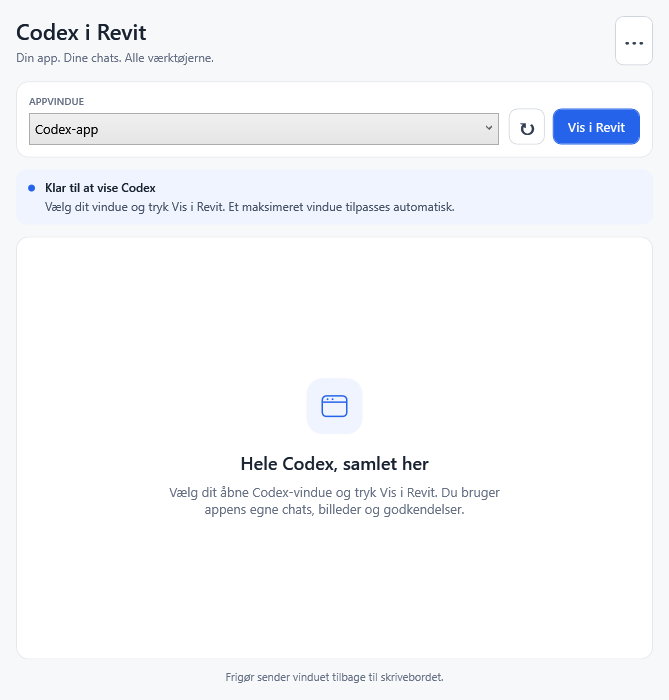

# Codex desktop app in Revit

Version 2.6.3 positions the **original Codex desktop window over the Revit panel** while preserving its native owner, frame and input handling. The user chose one original app window that can move between Revit and the desktop. This is an experimental Windows window-placement integration; compatibility with the actual Codex app still requires the user's trial.

## Use

1. Install with Revit closed. Start Revit and enable **Revit MCP Switch** for model tools.
2. Open **Codex Chat > Codex-vindue**. Keep Codex open and signed in.
3. Select the Codex app window and choose **Vis i Revit**. Use the refresh button if the window is missing.
4. Use Codex normally in the panel area. Choose **Frigør** to restore its frame and original placement.

During placement the panel switches to a compact toolbar, giving the app more vertical space. Status details are available in the toolbar label's tooltip; a paused window is labelled **På pause**. Version 2.6.3 converts WPF screen points through the exact host HWND into physical pixels before native placement. A DPI-changing move may reapply the size once; genuine app minimum sizes are still respected.

The original app receives input directly. Its native menus and dialogs can open as normal separate windows. **Vis igen** restores a manually minimized/maximized source and brings it back to the panel. A minimized/hidden host pauses placement and temporarily hides a normal source without minimizing it. Use **⋯ > Gendan tidligere placering** after an interrupted placement if the previous host is no longer running. Normal panel close/hide/shutdown releases the app first.

**⋯ > Levende forhåndsvisning** uses local DWM thumbnails to show a live, view-only image. An early mouse/keyboard-message relay worked for text but failed a native-button test and was removed. Do not describe the preview as an interactive screen-sharing session. **Tekstchat** retains the version 2.5 same-thread text interface, including its limited feature set.

## Window behavior

`DesktopOverlayLease` changes screen bounds and, when necessary, the temporary stacking band. New leases never change the source owner, native frame/styles, parent or DPI context. The original show state, placement and band are saved with PID/start-time identity in a local recovery file. Legacy records still restore the owner/frame changed by 2.6/2.6.1. Source processes are never terminated by the plugin.

Version 2.6.1 was rejected in the actual user trial: the panel was blank despite its green status, then the source became minimized. That is separate from the passing WinForms fixture tests. Cross-process ownership can implicitly couple input queues ([Microsoft explanation](https://devblogs.microsoft.com/oldnewthing/20130412-00/?p=4683/)); removing that relationship and preserving the compositor-based app's native style addresses a likely cause, not a proven actual-app success. Status now reports placement or pause rather than claiming app readiness. Diagnostics include cloaking, native classes/styles and foreground/focus metadata without reading chat content.

This project exposes 138 Revit model tools and builds on [LuDattilo/revit-mcp-server](https://github.com/LuDattilo/revit-mcp-server), preserving its license and notices.

## Build and verify

```powershell
dotnet build plugin/RevitMCPPlugin.csproj -c "Release R26"
dotnet run --project tests/window-mirror/WindowMirror.Tests.csproj
dotnet run --project tests/window-mirror/WindowMirror.Tests.csproj -- --dpi-host-probe
dotnet run --project tests/shared-chat/SharedChat.Tests.csproj
./tests/codex-panel/Test-Installer.ps1
```

The window test creates its own source app and host. It verifies composed preview/overlay pixels, different DPI modes, native owner/frame preservation, host minimize/restore, source pause/explicit resume, modal behavior and restoration. It does not operate user applications or prove compatibility with the actual Codex app. See [validation status](docs/shared-chat-status.md).

Optional manual preview without installing: run `tests/window-mirror/bin/Debug/net8.0-windows/WindowMirror.Tests.exe --preview <absolute path to RevitMCPPlugin.dll>` and use the visible controls yourself. The helper does not automatically select or operate Codex.

A complete installer package also needs the command set, MCP server, Node runtime and dependency DLLs. Keep models, credentials, databases, local settings and backups out of Git.

Windows references: [top-level window owner](https://learn.microsoft.com/en-us/windows/win32/api/winuser/nf-winuser-setwindowlongptrw), [DWM thumbnails](https://learn.microsoft.com/en-us/windows/win32/api/dwmapi/nf-dwmapi-dwmregisterthumbnail).

## Interface and previous 2.6.1 placement fix

Version 2.6.1 fixed saved maximize/minimize bits being reapplied after restoration. Controlled normal, maximized and minimized fixtures passed pixel and hit-test checks, but the actual Codex trial still failed. Version 2.6.2 keeps those restoration regressions and checks all four physical bounds while preserving the native owner/frame. It no longer claims app readiness from window geometry and hit testing.

The refreshed interface has one primary action, a readable Codex window label, a visible status card and a compact extra-actions menu. Controls adapt to narrow panels. Automatic raising pauses while the panel's own menus are open. A local window-diagnostics.json stores the last operation's window metadata and error, without chat content or credentials.

The source matches its current host's topmost band so a floating host cannot cover it. Desktop return restores the original band. Controlled tests keep their own host visible without taking foreground focus and verify original extended-style restoration.


